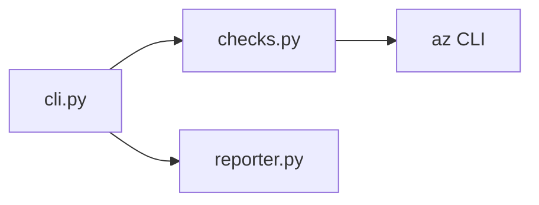

# Cloud Security Scanner

Python CLI for **Azure posture checks** — storage exposure, NSG rules, Key Vault, and SQL public access.

Runs live via `az` CLI, or **`--demo`** for offline portfolio output (no subscription required).

## Checks (5)

| ID | Check | Severity |
|----|--------|----------|
| AZ-STORAGE-001 | Storage account public blob access | HIGH |
| AZ-STORAGE-002 | Storage HTTPS-only disabled | MEDIUM |
| AZ-NSG-001 | NSG allows SSH/RDP/SMB from Internet | CRITICAL |
| AZ-KV-001 | Key Vault public network access | MEDIUM |
| AZ-SQL-001 | SQL server public network access | HIGH |

## Quick start (demo — no Azure)

```powershell
cd cloud-security-scanner
python -m src.cli scan --demo
```

## Live scan (after `az login`)

```powershell
az account show --query id -o tsv
python -m src.cli scan --subscription <SUBSCRIPTION_ID>
python -m src.cli scan -s <SUBSCRIPTION_ID> --format json
```

Exit code **1** if any CRITICAL or HIGH findings (CI-friendly).

## Example output (`--demo`)

```
SEVERITY   CHECK            RESOURCE                       TITLE
------------------------------------------------------------------------------------------
HIGH       AZ-STORAGE-001   rg-demo/sttfstateexample       Storage account allows public blob access
MEDIUM     AZ-STORAGE-002   rg-demo/stlogs001              Storage account allows insecure HTTP
CRITICAL   AZ-NSG-001       rg-network/nsg-aks/AllowSSH    NSG allows admin ports from Internet
MEDIUM     AZ-KV-001        kv-platform-dev                Key Vault public network access enabled
HIGH       AZ-SQL-001       sql-app-dev                    SQL server allows public network access

Summary: CRITICAL=1, HIGH=2, MEDIUM=2
```

## Architecture



## CI

Ruff lint on push via GitHub Actions.

## Roadmap

- [ ] AWS / GCP checks
- [ ] SARIF export for GitHub Code Scanning
- [ ] Policy-as-code mapping (CIS, MITRE)
