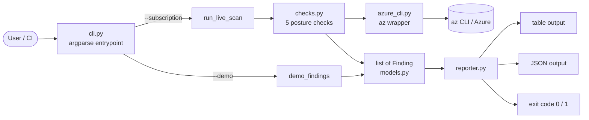

# Cloud Security Scanner

[](https://github.com/shohrabniaz/cloud-security-scanner/actions/workflows/ci.yml)
[](LICENSE)
[](https://www.python.org/)

A small, dependency-light **Azure security posture scanner**. It reads the live
state of a subscription through the `az` CLI, evaluates a set of
misconfiguration checks, and reports findings as a table or JSON with a
CI-friendly exit code.

## Problem

Cloud misconfigurations — publicly reachable storage, management ports open to
the Internet, data services with public network access — are a leading cause of
real-world breaches. Teams need a lightweight, auditable way to flag these
issues in a subscription without standing up a heavyweight platform, and to gate
pipelines on the results.

This project is a focused, readable reference implementation of that idea: each
check is a small pure function over Azure resource metadata, so the detection
logic is easy to review, test, and extend. It is intentionally not a
full-featured CSPM product — the goal is clarity and correctness over breadth.

## What it detects

Five posture checks, each mapped to a stable ID and severity:

| ID | Check | Severity |
|----|-------|----------|
| `AZ-STORAGE-001` | Storage account allows public blob access | HIGH |
| `AZ-STORAGE-002` | Storage account allows insecure HTTP (HTTPS-only disabled) | MEDIUM |
| `AZ-NSG-001` | NSG allows admin ports (SSH/RDP/SMB) from the Internet | CRITICAL |
| `AZ-KV-001` | Key Vault public network access enabled | MEDIUM |
| `AZ-SQL-001` | SQL server allows public network access | HIGH |

The scanner exits with code **1** when any **CRITICAL** or **HIGH** finding is
present, so it can fail a pipeline step. A check that errors (for example, a
missing login or role) is reported as an `INFO` `SCAN-ERROR` finding rather than
crashing the whole run.

## Architecture



- **`cli.py`** — argument parsing and dispatch (`--demo` vs. live `--subscription`).
- **`checks.py`** — the five checks plus `run_live_scan` orchestration and the
  offline `demo_findings` sample.
- **`azure_cli.py`** — a thin wrapper that runs `az ... -o json` and raises on
  failure.
- **`models.py`** — the `Finding` dataclass and `Severity` enum.
- **`reporter.py`** — table/JSON rendering and the CI exit-code policy.

## Quick start (demo — no Azure required)

The demo path emits representative findings offline, so you can try the tool and
read its output without a subscription.

```bash
git clone https://github.com/shohrabniaz/cloud-security-scanner.git
cd cloud-security-scanner
python -m src.cli scan --demo
```

## Live scan (after `az login`)

Requires the [Azure CLI](https://learn.microsoft.com/cli/azure/install-azure-cli)
and at least **Reader** on the target subscription.

```bash
az login
az account show --query id -o tsv          # find your subscription ID
python -m src.cli scan --subscription <SUBSCRIPTION_ID>
python -m src.cli scan -s <SUBSCRIPTION_ID> --format json
```

## Example output (`--demo`)

```text
SEVERITY   CHECK            RESOURCE                       TITLE
------------------------------------------------------------------------------------------
HIGH       AZ-STORAGE-001   rg-demo/sttfstateexample       Storage account allows public blob access
MEDIUM     AZ-STORAGE-002   rg-demo/stlogs001              Storage account allows insecure HTTP
CRITICAL   AZ-NSG-001       rg-network/nsg-aks/AllowSSH    NSG allows admin ports from Internet
MEDIUM     AZ-KV-001        kv-platform-dev                Key Vault public network access enabled
HIGH       AZ-SQL-001       sql-app-dev                    SQL server allows public network access

Summary: CRITICAL=1, HIGH=2, MEDIUM=2
```

JSON output (`--format json`) emits the same findings as an array of objects
with `check_id`, `title`, `severity`, `resource`, `detail`, and `remediation`
fields — convenient for piping into other tooling.

## Tests

The detection logic is covered by `pytest`. Azure calls are stubbed, so the
suite runs fully offline.

```bash
pip install -r requirements.txt
python -m pytest -q      # unit tests
ruff check src/ tests/   # lint
```

## Continuous integration

[GitHub Actions](.github/workflows/ci.yml) runs three jobs on every push and
pull request to `main`:

- **lint** — `ruff check` over `src/` and `tests/`.
- **test** — the `pytest` suite.
- **demo** — the offline `--demo` scan, treating the expected exit code `1`
  (findings present) as success.

## Roadmap

- [ ] AWS / GCP posture checks
- [ ] SARIF export for GitHub Code Scanning
- [ ] Policy-as-code mapping (CIS Benchmarks, MITRE ATT&CK)
- [ ] **LLM-assisted Infrastructure-as-Code (IaC) security repair** — go beyond
  detection toward suggesting and validating fixes to the underlying IaC
  (Terraform / Bicep) that produced a finding.

### Research context

The LLM-assisted repair direction above connects this tool to the author's PhD
research interest in IaC and cloud security. Relevant literature and prior art:

- Static IaC security analysis that this scanner is philosophically aligned with:
  [Checkov](https://www.checkov.io/), [KICS](https://kics.io/), and
  [Trivy / tfsec](https://trivy.dev/).
- Research on automated program and configuration repair with LLMs:
  [arXiv — LLM-based program repair](https://arxiv.org/list/cs.SE/recent) and the
  survey ["A Survey on Automated Program Repair Techniques"](https://arxiv.org/abs/2303.18184).
- Research on applying LLMs to Infrastructure-as-Code:
  [arXiv search — "LLM Infrastructure as Code"](https://arxiv.org/search/?searchtype=all&query=LLM+infrastructure+as+code)
  and broader [cloud security + machine learning literature](https://scholar.google.com/scholar?q=LLM+infrastructure+as+code+security+repair).

> Links above point to real, independent projects and public literature; they are
> provided as context for the roadmap, not as claims of current capability.

## License

Released under the [MIT License](LICENSE).
